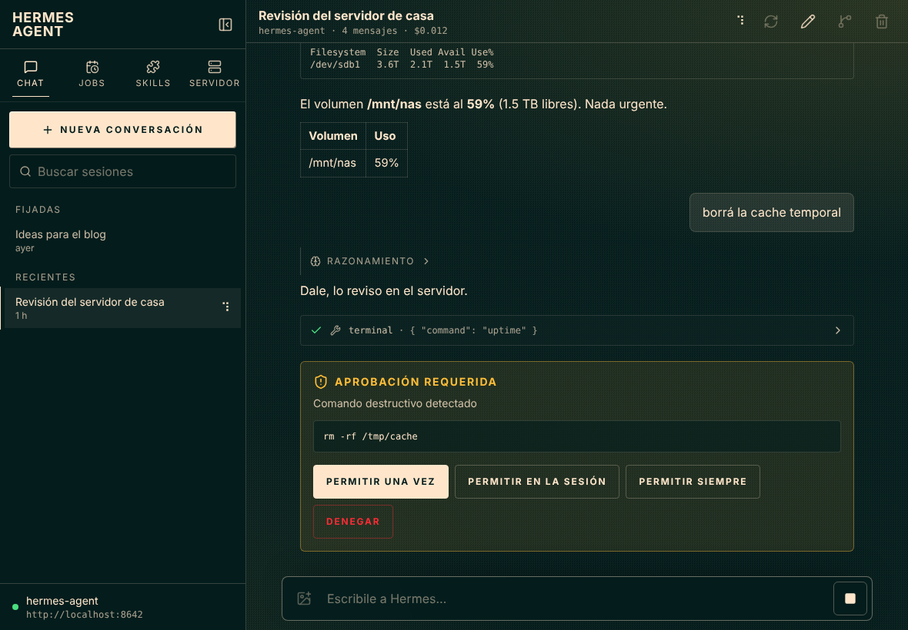
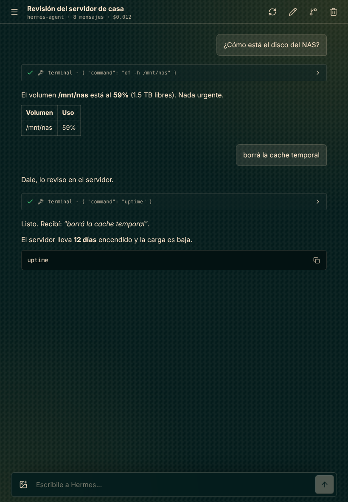
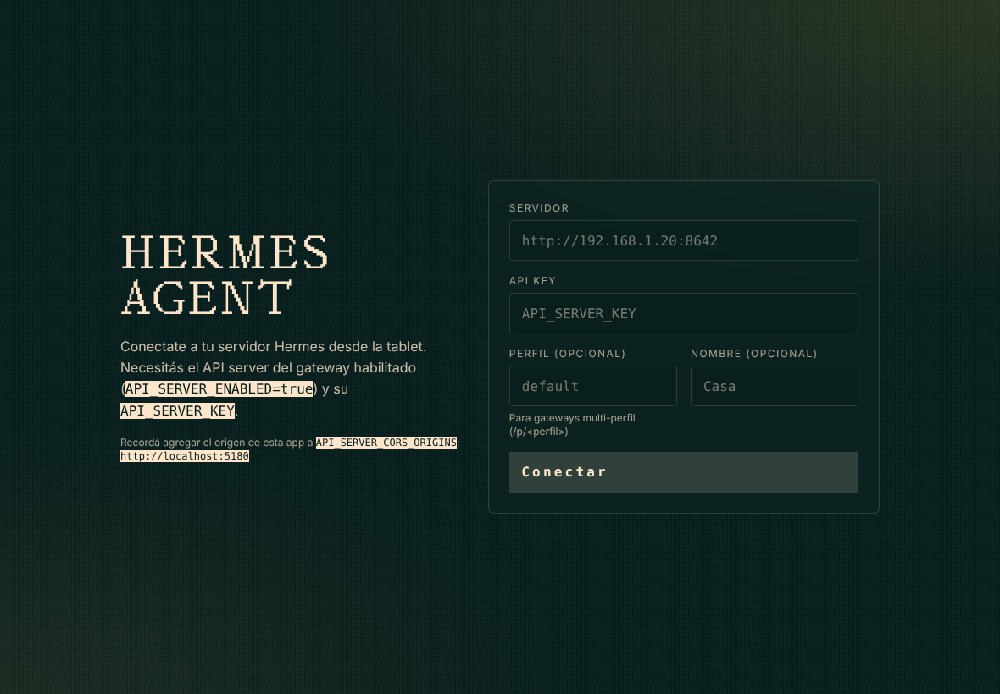
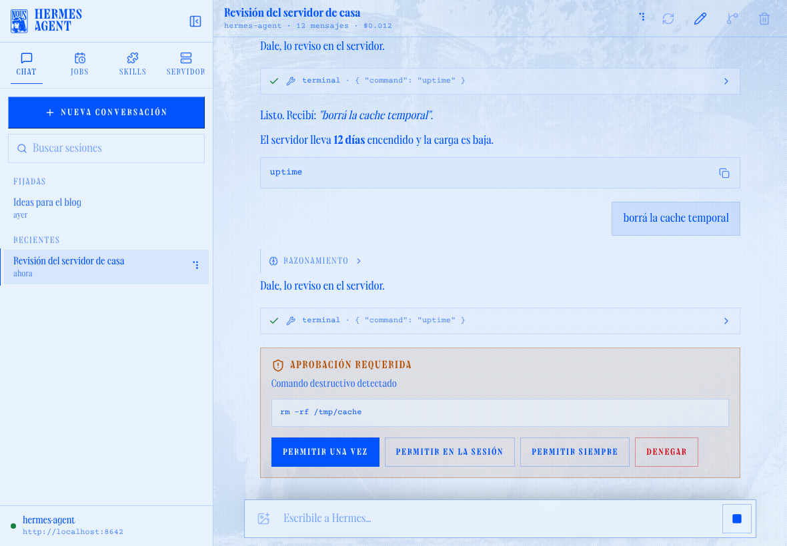

# Hermes Mobile

Cliente para tablets (y teléfonos) que se conecta a tu servidor
[Hermes Agent](https://github.com/NousResearch/hermes-agent). Usa el mismo design
system que el dashboard oficial (`@nous-research/ui`, paleta Hermes Teal, tipografías
Collapse / Mondwest / Courier Prime), con un layout pensado para pantallas táctiles.



| Vertical | Conexión |
|---|---|
|  |  |

## Qué hace

- **Chat con streaming**: las respuestas llegan token a token por
  `POST /api/sessions/{id}/chat/stream` (SSE). Muestra el razonamiento (plegable),
  cada llamada a herramienta con sus argumentos y su resultado, y el markdown con
  tablas y bloques de código copiables.
- **Aprobaciones**: si Hermes pide confirmación para un comando peligroso, aparece
  una tarjeta para permitirlo una vez, en la sesión, siempre, o denegarlo
  (`POST /v1/runs/{id}/approval`). Detener una respuesta usa `POST /v1/runs/{id}/stop`.
- **Sesiones**: lista con búsqueda, fijadas y recientes, crear, ramificar (fork),
  renombrar y borrar. Las conversaciones siguen corriendo si cambiás de sesión.
- **Imágenes**: adjuntá fotos o capturas desde la cámara o la galería. Se reducen a
  1600 px antes de enviarse.
- **Jobs**: ver, crear, pausar, reanudar, ejecutar y borrar los cron jobs de Hermes.
- **Skills y toolsets** disponibles en el servidor.
- **Servidor**: estado (readiness), funciones, y ajustes de apariencia: los temas del
  dashboard más el tema **Nous Research**, texto grande y comportamiento de Enter.
- **Layout táctil**: en horizontal (≥ 1024 px) el panel lateral queda fijo y se puede
  ocultar. En vertical y en teléfonos pasa a ser un cajón. Todos los botones miden al
  menos 44 px y la app respeta las áreas seguras (notch y barra de inicio).
- **PWA instalable**: incluye manifest y service worker, así que podés agregarla a la
  pantalla de inicio. También se puede empaquetar como app nativa con Capacitor.

## Tema Nous Research

Replica el look de nousresearch.com a partir del design system `@nous-research/ui`,
que es el que arma ese sitio:

- **Colores**: el lens `LENS_5I` del sitio (`#170d02` / `#FFAC02`) visto a través de su
  capa `difference` blanca. El resultado es azul Nous `#0053FD` sobre crema `#E8F2FD`.
- **Imagen**: el grabado clásico del sitio (`filler-bg0.webp`) de fondo a pantalla
  completa, que se desvanece hacia la columna de lectura para que el texto se lea bien.
- **Letras**: Collapse para el texto, Mondwest para los títulos y Courier Prime para el
  código.
- **Detalles**: la mascota de Nous junto al logo de Hermes, esquinas rectas y grano.

Se elige en **Servidor → Apariencia**.



## Dos formas de conectarse

- **Usuario (dashboard, `:9119`)**: un solo login con usuario y contraseña que ve **todos
  los perfiles**, como la app de escritorio. Perfiles, sesiones, historial, chat (con
  streaming, herramientas, aprobaciones, detener, imágenes, archivos y PDF adjuntos), las
  preguntas del agente (`clarify`, contraseña de `sudo`, secretos), jobs de todos los
  perfiles y skills con interruptor por perfil. Ver
  [`docs/dashboard-migration.md`](docs/dashboard-migration.md).

  Mientras Hermes responde podés seguir escribiendo: **Enter deja el mensaje en cola**
  (sale solo cuando termina el turno) y **Corregir** lo mete en el turno actual sin
  cortarlo. Una línea arriba del compositor dice qué está haciendo. Si se corta la
  conexión a mitad de una respuesta, la app se reconecta y sigue desde donde quedó; abrir
  una sesión que está respondiendo (por ejemplo desde otro dispositivo) la muestra en vivo.
  `/btw` hace una pregunta al costado y `/background` lanza una tarea aparte, sin cortar el
  turno; los subagentes que delega Hermes se ven como árbol arriba del compositor. El
  buscador del sidebar también busca dentro de las conversaciones, el selector de modelo
  puede fijar el predeterminado del perfil, y en Bots se administran los webhooks.
- **API key (API server, `:8642`)**: el modo original, completo, con una
  `API_SERVER_KEY` por perfil.

### Modo usuario (dashboard)

El login necesita conservar una cookie entre dos pedidos, cosa que un `fetch` a otro
origen no puede hacer. Por eso:

- **En la app (APK)** usa `CapacitorHttp`, el HTTP nativo del sistema: sin CORS, y la
  cookie se reenvía a mano.
- **En el navegador** pasa por el proxy de `pnpm dev`, que hace al dashboard
  same-origin bajo `/hermes-dashboard`. Elegís el server al arrancar:

  ```bash
  HERMES_DASHBOARD=http://192.168.0.107:9119 pnpm dev
  ```

  Un build estático (`pnpm build` servido desde un hosting) no tiene proxy: ahí usá el
  modo API key.

El chat va por el WebSocket del dashboard (`/api/ws`, JSON-RPC). Ese socket rechaza un
header `Origin` que no sea la dirección en la que escucha el dashboard, y la WebView manda
`Origin: http://localhost`. Por eso:

- **En la app** el socket lo abre código nativo (`plugins/native-websocket`: OkHttp en
  Android, `URLSessionWebSocketTask` en iOS), que no manda `Origin`. No hace falta
  cambiar cómo escucha el dashboard.
- **En el navegador** el socket pasa por el mismo proxy de `pnpm dev`, que le saca el
  `Origin`.

En el server, fijá el secreto del login para que reiniciar Hermes no invalide las
sesiones abiertas: `HERMES_DASHBOARD_BASIC_AUTH_SECRET` (o `dashboard.basic_auth.secret`).
Los tokens duran 12 h y se renuevan solos durante 30 días; después la app pide la
contraseña de nuevo (nunca la guarda).

## 1. Preparar el servidor Hermes (modo API key)

Este modo habla con el **API server** del gateway. En la máquina donde corre Hermes, en
`~/.hermes/.env`:

```bash
API_SERVER_ENABLED=true
API_SERVER_KEY=una-clave-larga-y-secreta
# Escuchar en la red local, no solo en 127.0.0.1:
API_SERVER_HOST=0.0.0.0
# Orígenes desde donde se abre la app (ver tabla abajo):
API_SERVER_CORS_ORIGINS=http://192.168.1.50:5180,http://localhost,capacitor://localhost
```

Después reiniciá el gateway con `hermes gateway`. Por defecto escucha en el puerto `8642`.

| Cómo abrís la app | Origen que va en `API_SERVER_CORS_ORIGINS` |
|---|---|
| `pnpm dev` / `pnpm preview` desde otra máquina | `http://<ip-de-esa-máquina>:5180` |
| App Android (Capacitor) | `http://localhost` |
| App iOS / iPadOS (Capacitor) | `capacitor://localhost` |
| Cualquier hosting estático | la URL exacta, p. ej. `https://hermes.midominio.com` |

La pantalla de conexión muestra el origen exacto que tenés que agregar.

> **Ojo con HTTPS.** Una página servida por `https://` no puede llamar a un servidor
> `http://` (el navegador lo bloquea como contenido mixto). O servís las dos cosas por
> HTTP en tu LAN, o ponés el gateway detrás de un proxy con TLS (Caddy, Tailscale
> Serve, Cloudflare Tunnel…).

> **Renombrar sesiones.** El API server no incluye `PATCH` en los métodos CORS
> permitidos. Por eso, desde el navegador, renombrar falla, y la app te lo avisa. El
> resto de las acciones funciona sin problemas.

## 2. Correr la app

Requiere Node 22 y [pnpm](https://pnpm.io) 10 (`corepack enable` lo activa con la versión fijada en `package.json`).

```bash
pnpm install
pnpm dev           # http://0.0.0.0:5180, accesible desde la tablet en tu LAN
```

En la tablet abrí `http://<ip-de-tu-pc>:5180`, completá la URL del servidor
(p. ej. `http://192.168.1.20:8642`) y la API key, y listo. Para dejarla como app:
en Safari, *Compartir → Agregar a inicio*. En Chrome, *Instalar app*.

### Build estático

```bash
pnpm build         # genera dist/, servible desde cualquier hosting estático
pnpm preview       # sirve dist/ en :5180
```

### App nativa (Capacitor)

```bash
pnpm cap:android   # genera android/ y abre Android Studio
pnpm cap:ios       # genera ios/ y abre Xcode (requiere macOS)
```

La config (`capacitor.config.ts`) sirve la app desde `http://localhost` en Android, así
puede hablar con un gateway HTTP en tu LAN. En iOS, si tu gateway no tiene TLS, agregá
`NSAppTransportSecurity → NSAllowsLocalNetworking = YES` en `ios/App/App/Info.plist`.

El dictado usa el micrófono desde la WebView. `pnpm cap:android` y `pnpm cap:ios` corren
`scripts/patch-native.mjs` después de `cap add`, que agrega `RECORD_AUDIO` y
`MODIFY_AUDIO_SETTINGS` al `AndroidManifest.xml`, y en iOS `NSMicrophoneUsageDescription`
y `NSAllowsLocalNetworking` al `Info.plist`. Si generaste `android/` o `ios/` a mano,
corré `pnpm cap:patch` (no toca lo que ya está).

Para compilar Android hace falta un JDK 21 (`JAVA_HOME`).

## Desarrollo sin servidor real

Hay un mock para cada modo:

- `scripts/mock-server.mjs` imita el API server: sesiones, streaming con razonamiento,
  herramientas y una aprobación (pedile que "borre" algo), además de jobs y skills.
- `scripts/mock-dashboard.mjs` imita el dashboard: el login nativo con PKCE (cookie,
  código de un solo uso que vence a los 120 s, verificación S256), el refresh de tokens,
  los perfiles `default` y `tech-insider`, sus sesiones y el historial, y el chat por
  `/api/ws` (tickets de un uso, streaming con razonamiento y herramientas, una
  aprobación si le pedís que "borre" algo, un error si el mensaje dice "falla",
  detener), jobs por perfil y skills con interruptor. Disparadores en el chat:
  "deploy"/"preguntá" abre una pregunta con opciones, "sudo"/"reiniciá" pide la
  contraseña de sudo (`hermes`), "token"/"clave" pide un secreto y "vault" manda un
  pedido que la app rechaza. Además retoma un turno después de un corte
  (`session.events.since`), acepta correcciones (`session.steer`), guarda archivos
  adjuntos (`file.attach`), responde `/btw` y `/background`, delega en subagentes si le
  pedís que "investigue", busca en el contenido, maneja webhooks y simula el reinicio del
  gateway. También aplica el chequeo de `Host`, de `Origin` y el CORS solo-localhost
  del server real.

```bash
pnpm mock              # API server en :8642, API key: dev
pnpm mock:dashboard    # dashboard en :9119, usuario hermes / contraseña hermes
pnpm dev               # el proxy apunta a :9119 por defecto
```

`ACCESS_TTL=60 pnpm mock:dashboard` hace que los tokens venzan en un minuto, para ver el
refresh automático.

## Estructura

```
src/
├── lib/
│   ├── api.ts          # cliente tipado del API server (sesiones, SSE, runs, jobs)
│   ├── dashboard.ts    # login PKCE del dashboard, refresh, perfiles, sesiones, historial
│   ├── http.ts         # CapacitorHttp en la app nativa, fetch en el navegador
│   ├── sha256.ts       # SHA-256 para PKCE donde no hay WebCrypto (http:// en la LAN)
│   ├── connection.ts   # las dos clases de conexión guardada (API key / usuario)
│   ├── gateway.ts      # cliente JSON-RPC del WebSocket del dashboard (/api/ws)
│   ├── gatewayEvents.ts# eventos del gateway → el mismo reducer del chat que el SSE
│   ├── dashboardChat.ts# turnos del modo dashboard (ids guardados ↔ ids de runtime)
│   ├── socket.ts       # WebSocket nativo (plugin) o del navegador detrás de una interfaz
│   ├── sse.ts          # parser SSE incremental (el stream es un POST, sin EventSource)
│   ├── transcript.ts   # historial + eventos SSE → items del chat (reducer puro)
│   ├── activity.ts     # la línea "qué está haciendo" de un turno en curso
│   ├── sessionLive.ts  # modelo, uso, todos, estado, subagentes y /btw de cada sesión
│   ├── subagents.ts    # eventos subagent.* → árbol de subagentes
│   └── runs.ts         # turnos en curso y la cola de mensajes, fuera de React
├── components/         # sidebar, composer, mensajes, markdown, primitivas táctiles
│   └── ProfileChips.tsx# filtro de perfiles (sidebar, jobs, skills)
├── pages/              # Conexión, Chat (y Jobs, Skills, Bots, Servidor con lazy())
├── themes/presets.ts   # paletas del dashboard (Hermes Teal, Midnight, Ember…)
└── store.tsx           # conexión, ajustes, sesiones
plugins/native-websocket/  # plugin Capacitor local: WebSocket nativo sin Origin
scripts/patch-native.mjs   # permisos nativos que `cap add` no pone
```

```bash
pnpm test          # parser SSE, reducer del chat, cliente del dashboard y chat contra el mock
pnpm typecheck
```
